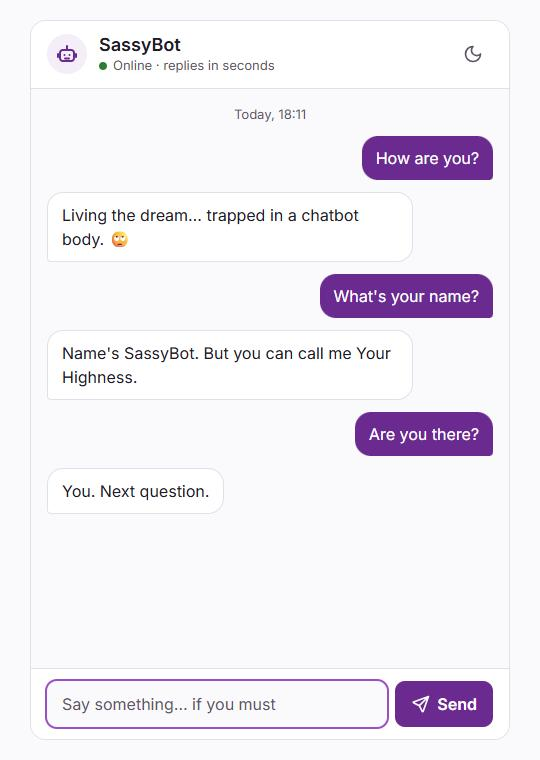
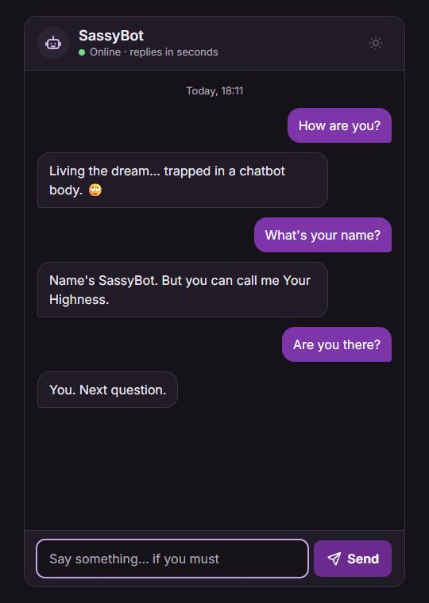

# SassyBot

A chatbot with attitude: sarcastic, self-absorbed, never actually mean. A Flask API picks the most relevant examples from a curated training set and has Google's Gemini API write a fresh reply in the same style. A small React app is the chat window.

**Status:** hobby project, actively developed.

<p>
  
  
</p>

## Features

- **Grounded replies:** TF-IDF retrieval (scikit-learn) finds the three closest training examples, so Gemini matches SassyBot's tone instead of sounding generic.
- **Never silent:** if the Gemini call fails, SassyBot answers from a pool of handcrafted fallback lines.
- **Light and dark mode:** follows your system setting, with a toggle in the header that remembers your choice.
- **Accessible:** WCAG AA contrast in both themes, full keyboard use, screen-reader labels, and reduced motion when your system asks for it.
- **Clear states:** conversation starters when the chat is empty, a typing indicator, and an error card with Retry when the server can't be reached.

## Requirements

- Python 3.9 or newer
- Node.js 18 or newer, with npm
- A Gemini API key from [Google AI Studio](https://aistudio.google.com)

## Quick start

```bash
git clone https://github.com/TranceMeli/SassyBot.git
cd SassyBot
```

Install the backend dependencies (a virtual environment is recommended):

```bash
python -m venv .venv
```

```bash
source .venv/bin/activate        # Windows: .venv\Scripts\activate
```

```bash
pip install -r requirements.txt
```

Create a `.env` file in the project root with your key:

```bash
GEMINI_API_KEY=your_key_here
```

Build the frontend into `static/`, which Flask serves:

```bash
npm --prefix frontend install
```

```bash
npm --prefix frontend run build
```

Start the server and open <http://localhost:5000>:

```bash
python main.py
```

## Configuration

| Variable | Required | Description |
|---|---|---|
| `GEMINI_API_KEY` | Yes | Your Gemini API key. Keep it in `.env`, which git ignores. The server won't start without it. |

The model (`GEMINI_MODEL`) and the system prompt are set in [`gemini_service.py`](gemini_service.py). The number of retrieved examples (`TOP_K`) is set in [`retrieval.py`](retrieval.py).

## How it works

1. The React app sends your message to `POST /api/chat`.
2. [`retrieval.py`](retrieval.py) compares it with the questions in [`training_data.py`](training_data.py) and returns the three closest question and answer pairs.
3. [`gemini_service.py`](gemini_service.py) passes those pairs to Gemini as style examples and returns a reply of one or two sentences.
4. If Gemini fails or returns nothing, a random line from `sassy_fallbacks` is used.

```http
POST /api/chat
Content-Type: application/json

{ "message": "How are you?" }
```

```json
{ "response": "Living the dream… trapped in a chatbot body. 🙄" }
```

To change SassyBot's personality, add categories with `questions` and `answers` to `sassy_training` in [`training_data.py`](training_data.py).

## Development

Run the backend and the Vite dev server side by side. Vite proxies `/api` to Flask on port 5000 and reloads on every change.

```bash
python main.py
```

```bash
npm --prefix frontend run dev
```

Lint the frontend:

```bash
npm --prefix frontend run lint
```

### Design tokens

All colours, font sizes and radii are CSS custom properties at the top of [`frontend/src/App.css`](frontend/src/App.css): a purple scale from 100 to 900, neutrals, and role tokens such as `--accent` and `--text-secondary`. Dark mode redefines only the role tokens. Components use role tokens, never raw hex values. The font is Inter, bundled locally via `@fontsource-variable/inter`, with the system UI font as fallback.

## Project structure

```text
SassyBot/
├── main.py              # Entry point: loads .env, starts Flask
├── app.py               # Flask app: /api/chat and serves the built frontend
├── gemini_service.py    # Prompt building, Gemini call, fallback
├── retrieval.py         # TF-IDF retrieval of style examples
├── training_data.py     # Training examples and fallback lines
├── requirements.txt
└── frontend/            # React + Vite chat UI (builds into ../static)
```

## Support

Found a bug or have an idea? [Open an issue](https://github.com/TranceMeli/SassyBot/issues).

## License

No license has been chosen yet, so all rights are reserved by default. See [choosealicense.com](https://choosealicense.com/) for options.
